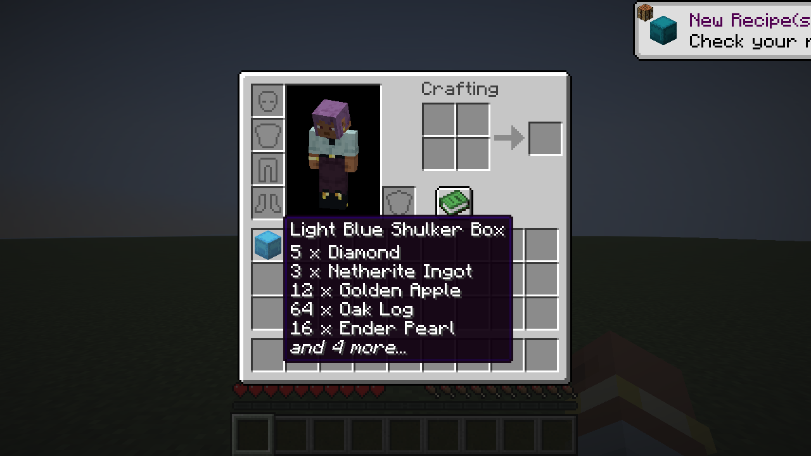
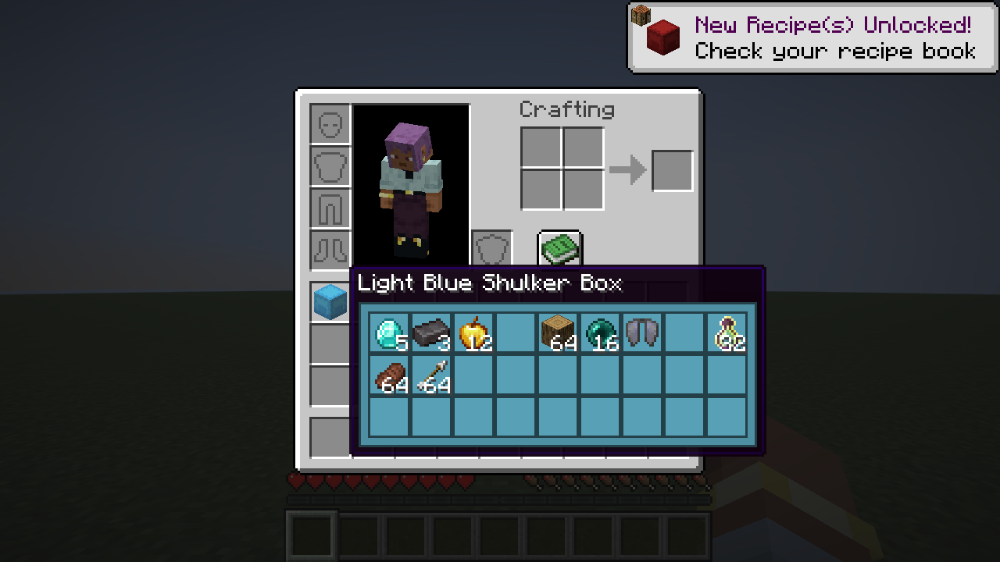
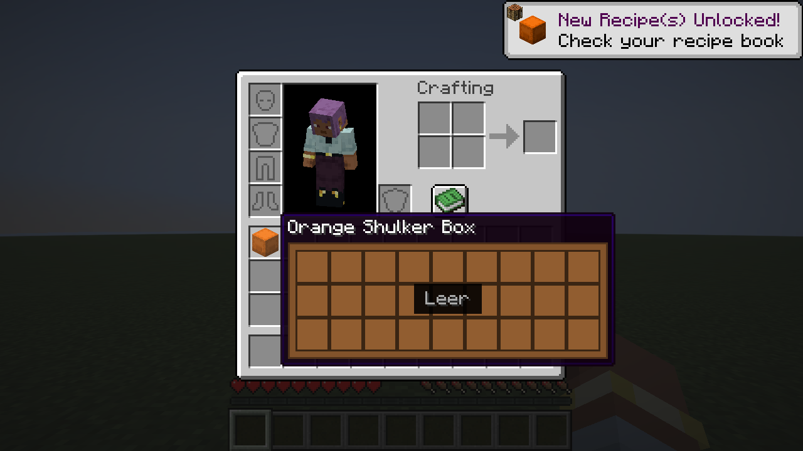
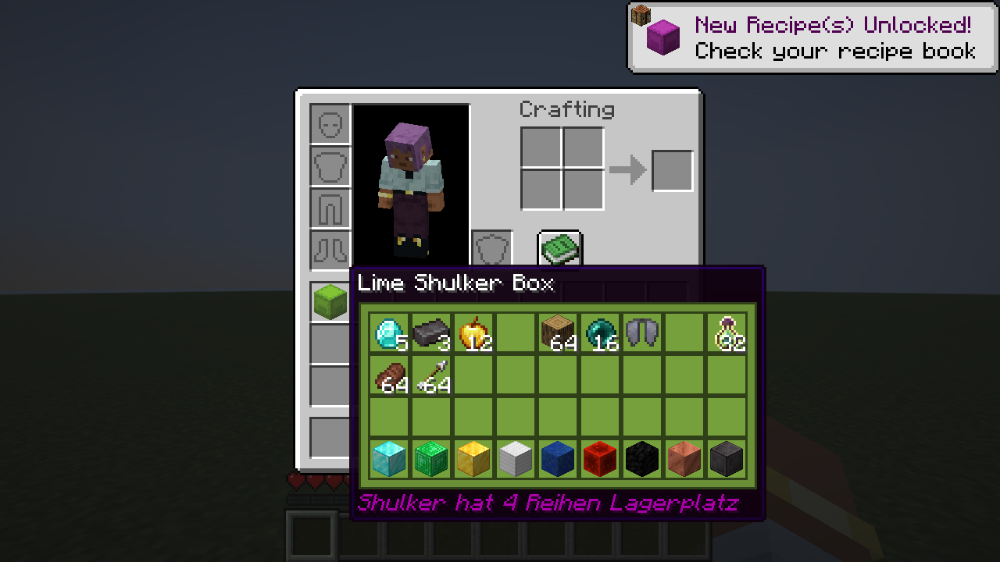
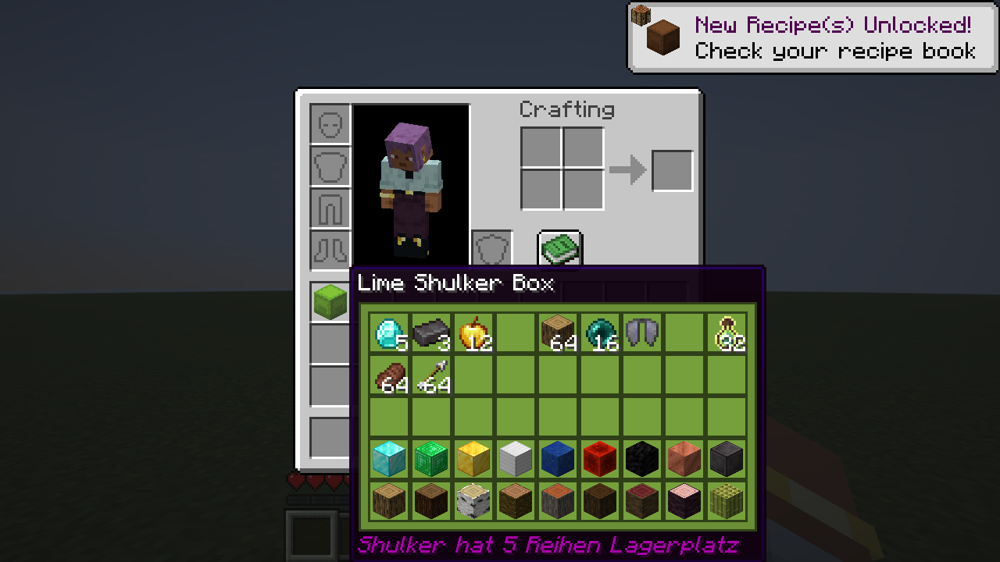
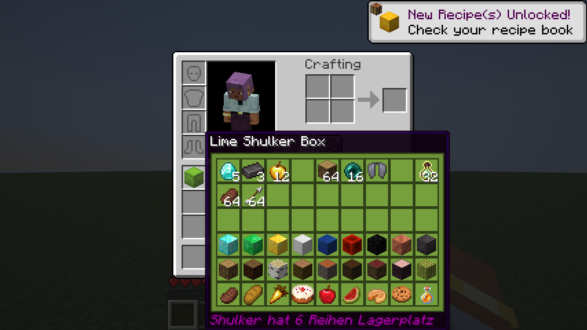
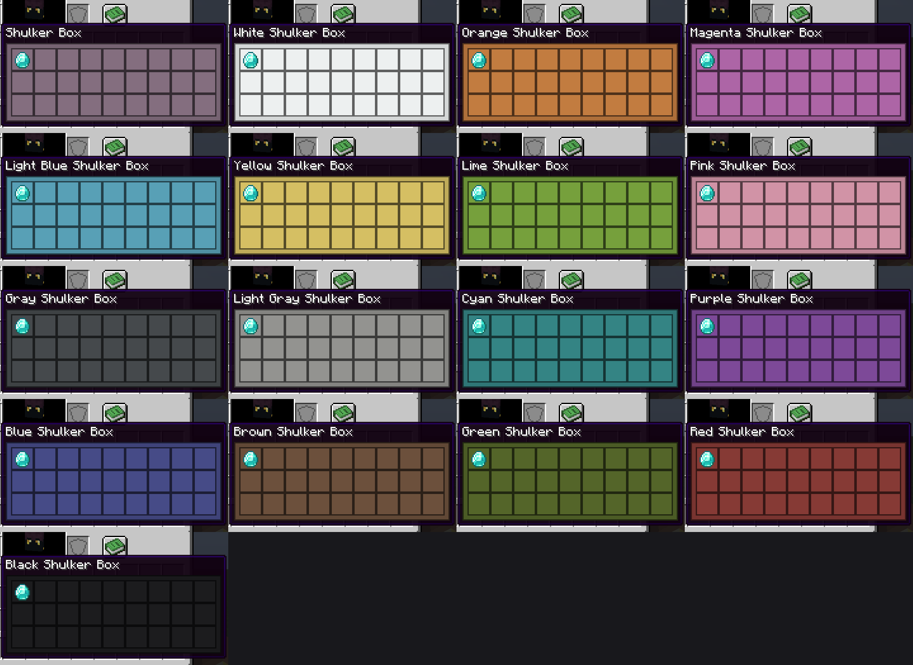

# Prime Shulker Tooltip

Fabric-Mod für Minecraft 26.3. Zeigt im Tooltip jeder Shulkerkiste, **was in welchem Slot liegt**, ohne sie zu öffnen oder zu platzieren. Funktioniert auch mit den Custom-Shulkergrößen (4 bis 6 Reihen).

Autor: BIG_Gamba

## Features

- **Shift halten = Raster:** Ohne Shift bleibt die normale Anzeige. Mit Shift erscheint der volle Inhalt als Raster, jeder Gegenstand genau an seinem Slot, inklusive Stackgröße.
- **Alle Größen:** 3 Reihen (normal) und Custom-Größen mit 4, 5 und 6 Reihen. Die Größe wird automatisch erkannt.
- **Leere Kisten:** Eine leere Shulker zeigt das leere Raster mit "Leer".
- **Farbe der Kiste:** Alle 16 Shulkerfarben plus die lila Standard-Kiste haben ihre eigene Hintergrundfarbe.
- **Nur Anzeige:** Der Mod ist rein clientseitig, ändert nichts am Spiel und gibt keine Vorteile außer der Übersicht. Kein Server-Mod nötig.

## Screenshots

| Ohne Shift | Mit Shift |
|---|---|
|  |  |

| Leere Kiste | 4 Reihen |
|---|---|
|  |  |

| 5 Reihen | 6 Reihen |
|---|---|
|  |  |



Die Screenshots entstanden in einem automatischen Testspiel mit nachgebauten Kisten.

## Installation

1. Fabric Loader (0.19.5 oder neuer) und Fabric API für Minecraft 26.3 installieren.
2. Die JAR aus den [Releases](../../releases) in den `mods`-Ordner legen.

## Selbst bauen

Benötigt Java 25.

```
./gradlew build
```

Die fertige JAR liegt danach in `build/libs/`.

## Hinweise

- Der Mod kann nur anzeigen, was der Server an den Client schickt. Enthält eine Kiste keine Daten (zum Beispiel bei manchen Server-Menüs), erscheint sie als leer.
- Die Zusatzreihen der Custom-Shulker werden aus den Item-Daten gelesen. Ändert der Server dieses Format, muss der Mod angepasst werden.

## Lizenz

MIT, siehe [LICENSE](LICENSE).
